## Hi, I'm Ezra 👋

I'm a medical student and BSc Human Anatomy graduate from the University of Nairobi. I build the software behind small businesses: backend APIs, storefronts and the dashboards that run them. My long-term goal is to bring the same approach to healthcare.

## Flagship project: Pyfon

[**Pyfon**](https://github.com/MoRanauk/pyfon) is a platform for a printing and branding business. A single Node.js backend serves every frontend, so products, orders and customers are shared across the whole system. Three customer storefronts take the orders, and a partner dashboard lets the team manage jobs and message customers.

Every part of it is live:

| App | What it does |
|---|---|
| [M & Co. Brands](https://pyfon-mco.moranauk.workers.dev/) | Customer storefront |
| [Pyfon Gift Hub](https://pyfon-gifthub.moranauk.workers.dev/) | Customer storefront for gifts |
| [TriM Atelier](https://pyfon-trimatelier.moranauk.workers.dev/) | Customer storefront for jewellery, timepieces and fragrance |
| [M3 Labs](https://pyfonlab.moranauk.workers.dev/) | Partner dashboard: jobs, approvals and customer messaging |
| [Studio](https://pyfon-studio.moranauk.workers.dev/) | Developer studio with a drag-and-drop page builder |

**Built with:** Node.js, Express, React, Vite, PostgreSQL on Neon, with the backend on Render and the frontends on Cloudflare.

## Where it started

Pyfon grew out of two earlier shop projects, where I learned to build and deploy backends.

| Project | What it does | Stack |
|---|---|---|
| [Emlabs-backend](https://github.com/MoRanauk/Emlabs-backend) | Clothing shop API with a seeded 30-item catalog. My first shop backend, and the model for Pyfon's design. | Node.js, Express, MongoDB, Mongoose |
| [business-website](https://github.com/MoRanauk/business-website) | React business website served by an Express backend as a single deployable unit | Node.js, Express, React |

## Tools I work with

**Backend:**  

**Frontend:**  

**Data:**   

**Hosting and workflow:**   

## Background

I hold a BSc in Human Anatomy, and my undergraduate research looked at how maternal exposure to aflatoxin B1 affects kidney development. I'm now training in medicine while building software, with the aim of making tools that work for the people who run clinics and care for patients.

## Get in touch

[Email](mailto:moranauk@gmail.com) · [Blog](https://empearls.beehiiv.com/)
